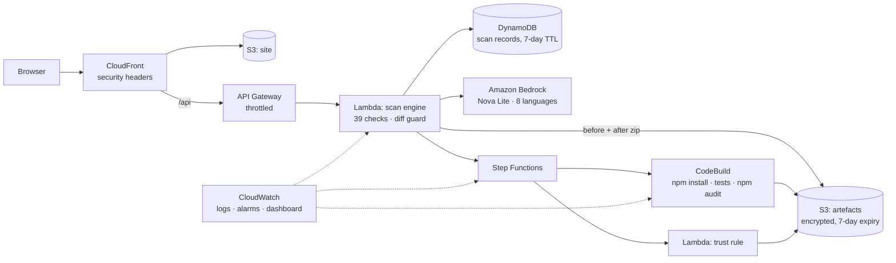

# Siidekick

**A security engineer for every Indian student, college and small business that ships code without one.**

Siidekick reads your code, finds the holes that hurt Indian users (fake UPI and Razorpay payments, leaked Aadhaar numbers, OTPs handed to attackers, keys in the repo), explains each one in your own language, fixes it without touching your code, and **proves the fix on AWS before you merge it**.

**[Live on AWS →](https://d1ulntgja5qae0.cloudfront.net)** · **[Try the demo in one click →](https://d1ulntgja5qae0.cloudfront.net/app?demo=1)** · Built for the Campus to Cloud Hackathon (AWS × Techfest, IIT Bombay) by **Schrödinger's Code**, a part of Echelon Systems Architecture.

---

## The 30-second version

CampusKart is a college-fest merch shop, the kind of site thousands of Indian students build every year. Its checkout trusts the Razorpay payment id that the browser sends. So anyone can type a made-up payment id and get a fest pass **for a payment that never happened**.

Siidekick finds that bug, explains it in Hindi, fixes it with added lines only, and then **fires the same fake payment at the fixed shop on a live server: rejected.** A correctly signed payment still goes through.

All numbers below were measured on the live AWS deployment on 28 November 2026:

| | Before | After Siidekick |
|---|---|---|
| Security score | **33** / 100 | **62** / 100 |
| Failing checks | 23 | 12 |
| Checks that can expose personal data (DPDP-relevant) | 11 | 6 |
| Fake Razorpay payment | `200`: pass issued | `400`: rejected (a real signed payment still passes) |
| Live attacks that work against the shop | 7 | 1 |
| Vulnerable packages (independent `npm audit` in AWS CodeBuild) | 8 | **0** |
| The shop's own tests | 4 / 4 pass | 4 / 4 pass |
| Lines of the owner's code deleted | | **0** (+209 added; 8 declared replacements: keys to env vars, version bumps) |
| Time to proof on AWS | | **Verified in 74 s** |

The remaining 12 checks are left to the owner on purpose: rewriting a SQL query or moving an AI key off the browser are decisions, and Siidekick never rewrites your code. Each comes with the exact fix and an explanation in your language.

## Why this matters for India

- **India's attack surface is growing fast.** CERT-In handled over 29.44 lakh cyber incidents in 2025 ([PIB](https://static.pib.gov.in/WriteReadData/specificdocs/documents/2026/jan/doc2026123764501.pdf)).
- **The law now expects safeguards.** Under the DPDP Rules, notified on 14 November 2025, failing to keep reasonable security safeguards can draw a penalty of up to ₹250 crore ([PIB](https://static.pib.gov.in/WriteReadData/specificdocs/documents/2025/nov/doc20251117695301.pdf)). CERT-In expects listed incidents to be reported within 6 hours ([CERT-In](https://www.cert-in.org.in/PDF/CERT-In_Directions_70B_28.04.2022.pdf)).
- **Security tools speak English, and only to experts.** 98% of Indian internet users go online in Indic languages ([Kantar–IAMAI 2024](https://www.iamai.in/sites/default/files/research/Kantar_%20IAMAI%20report_2024_.pdf)).
- **The people building India's everyday sites have no security engineer:** fest and club websites, college portals, small shops going online, student startups, often written fast and with AI.

Most Indians will never see the code behind the sites they pay on, log in to with an OTP, or hand their Aadhaar to. Siidekick makes sure someone checked it.

## What it does

**Scan → Explain → Fix → Prove → Ship → Keep watching**

1. **Scan.** Paste a GitHub repo, upload a folder, or try the demo shop. 39 checks read the code as text on AWS Lambda, and nothing is ever run. Vulnerable dependencies are checked against [OSV.dev](https://osv.dev), and Siidekick rebuilds the dependency graph from `package-lock.json` to show *how* a bad package got in: `your app → express → qs`.
2. **Explain, in your language.** Amazon Bedrock explains any finding in English, Hindi, Bengali, Marathi, Tamil, Telugu, Gujarati or Kannada: what could happen, what to do, the options and their trade-offs, and what the evidence can't tell you.
3. **Fix, without touching your code.** Fixes are small, deterministic templates that only add lines. A diff guard refuses any patch that deletes or rewrites owner code, and nothing lands until you approve it.
4. **Prove it, on AWS.** Step Functions runs your original and fixed code side by side in a throwaway CodeBuild container: `npm install`, *your own* tests, and an independent `npm audit`. On the demo shop, a live attack replay fires real attacks at both copies.
5. **Ship.** Download the fixes (with one `.patch` file per fix and a log), or open a GitHub pull request that carries the fixes, the refreshed lockfile and the verification evidence. A human still clicks merge.
6. **Keep watching.** The [Siidekick GitHub Action](action/README.md) scans every push and pull request and puts findings as annotations on the changed lines.

## Built for India: the Bharat Pack and the India lens

Generic scanners don't know how Indian apps go wrong. Siidekick does:

| Check | What it catches | What happens |
|---|---|---|
| **Payments verified on the server** | A Razorpay payment id accepted without checking `razorpay_signature`; a Paytm/UPI callback that trusts `STATUS === "TXN_SUCCESS"` from the request | Razorpay: auto-fixed with a constant-time HMAC check wired into the route. Callbacks: the exact fix is shown |
| **Indian payment and SMS keys** | Razorpay, Paytm, PhonePe, Cashfree, PayU, Instamojo, CCAvenue, MSG91, Fast2SMS and Textlocal keys in code, named by vendor with the money risk explained | Moved to environment variables automatically |
| **Aadhaar, PAN and UPI data** | Aadhaar numbers in code (validated with UIDAI's Verhoeff checksum, which keeps phone numbers and ids out), PAN numbers, and identity data written to logs | Evidence is always masked: `XXXX XXXX 1234` |
| **OTP logins** | The OTP returned in the API response, written to logs, or generated with `Math.random` | Exact fix shown (`crypto.randomInt`, send by SMS only) |

The **India lens** at the top of every scan puts it in context, with sources:
- how many failing checks can expose personal data (relevant to the DPDP Act);
- whether the repo is ready for CERT-In's 6-hour incident report (the incident playbook Siidekick adds includes an India reporting section);
- what the India-specific checks found.

It's context for prioritising, not legal advice.

## What makes it different

Dependency scanners and AI autofix exist. Siidekick's difference is that every claim it makes is checked by something other than itself.

1. **The AI never writes your code.** Fixes are deterministic templates behind a diff guard enforced in code ([`diffGuard.ts`](packages/engine/src/diffGuard.ts)). Bedrock only explains.
2. **The AI can't invent facts.** Every explanation goes through an evidence check: if it names a CVE, advisory id or version that isn't in the scan's evidence, it's retried once, then rejected and labelled.
3. **"Fixed" means proven.** A fix is **verified** only when the fixed copy installs, *your* tests pass, and an independent source (`npm audit`, separate from the OSV.dev data the scan uses) no longer reports the flagged packages. A fix that breaks tests that used to pass is flagged as a **regression**. No tests means **inconclusive**, never verified.
4. **The attack is replayed.** On the demo shop, the same requests are fired at the app before and after the fix, each with a control request proving real users still get through, so "blocked" never just means "broken".
5. **Costs are shown, not hidden.** The Impact charts show what got worse too: the express upgrade takes the demo from 51 to 69 installed packages and makes installs slower, while vulnerable packages drop from 8 to 0.

## See the impact

The Verify & ship step ends with an **Impact** section, drawn only from measured data:
- score before and after;
- failing checks by severity;
- `npm audit` counts from CodeBuild;
- the dependency tree turning from red to green;
- lines added and removed per fix;
- the AWS run's timeline;
- build metrics: installed packages, `node_modules` size, install and test time.

A one-click **impact card** (PNG) carries the same numbers for slides and reports. A chart without data says so; nothing is estimated.

## Built on AWS



| Service | Why |
|---|---|
| CloudFront + S3 | One HTTPS domain for site and API (no CORS to get wrong), with HSTS, CSP and frame-blocking on every response; private bucket via Origin Access Control |
| API Gateway + Lambda | Pay-per-request scans; throttled to cap the cost of a public tool; arm64 |
| DynamoDB | Scan records, gzipped, deleted automatically after 7 days |
| Amazon Bedrock (Nova Lite) | First-party model on Free Tier credits, called in-region; explanations in 8 Indian languages |
| Step Functions + CodeBuild | A real, disposable build for untrusted code, with time, CPU and concurrency limits, orchestrated without an idle Lambda |
| CloudWatch | Structured audit trail, alarms on API errors and failed runs, one dashboard for the whole pipeline |
| IAM | A least-privilege role per component; the build can touch only its own job's files |

Everything is one AWS SAM template ([`infra/template.yaml`](infra/template.yaml)) and one command. The reasoning for each service is in [docs/BUILD_SUMMARY.md](docs/BUILD_SUMMARY.md).

## Try it (5 minutes)

1. Open **[the demo](https://d1ulntgja5qae0.cloudfront.net/app?demo=1)**. The scan lands at 33/100. Read the **India lens** card.
2. Open **"Online payments are verified on the server"** and **"Dependency vulnerability audit"** (see the `your app → express → …` path).
3. Set **AI explains in** to हिन्दी and press **Explain simply**.
4. Go to **Fixes**, open a diff, then **Approve all guard-passed**.
5. Go to **Verify & ship**:
   - **Replay the attacks**, and watch the fake payment get rejected;
   - **Run verification**, about 75 seconds on CodeBuild;
   - scroll through **Impact** and download the impact card.

Or scan your own public repo by pasting its GitHub URL.

## Use it on every pull request

```yaml
# .github/workflows/siidekick.yml
name: Siidekick
on: { push: { branches: [main] }, pull_request: {} }
permissions: { contents: read }
jobs:
  scan:
    runs-on: ubuntu-latest
    steps:
      - uses: actions/checkout@v5
      - uses: forstudies506-pixel/Siidekick/action@main   # pin a commit SHA in production
        with: { fail-on: none }                            # or critical / high / medium
```

Findings appear on the PR's changed lines and in the job summary, with a link to the full report. `.env` files are never sent; a committed one is flagged from the runner. Details: [action/README.md](action/README.md).

## Security of Siidekick itself

- Scanned code is read as text, never executed on the API. Only the verification build runs it, in a throwaway container with install scripts disabled and the build's AWS credentials removed before any repo code runs.
- The verification role can read only its own job's source zip and write its own output and logs.
- GitHub tokens for pull requests are used once, never stored or logged; PRs are only proposed.
- Data at rest is encrypted, both buckets are private, the artefacts bucket refuses non-TLS requests, and scan records expire after 7 days.

## Honest limits

- The attack replay runs only on the bundled demo shop; your code is never run on the API.
- The verification build has internet access so `npm install` can reach the registry. Removing it would need a NAT gateway, which isn't free, so we limit what a hostile build could do instead.
- Some fixes are the owner's call by design: SQL rewrites, browser AI keys and Paytm/UPI callbacks are reported with the exact fix, not auto-applied.
- The rescan reads your current lockfile, so a dependency bump shows as fixed in the scan only after you commit the refreshed lockfile (the PR includes it); CodeBuild proves it before that.
- AI explanations are checked against the evidence but are still AI. The scanner text is the source of truth, and the Hindi copy is being reviewed by native speakers.
- The India lens is context, not legal advice.

## Run it locally

Needs Node ≥ 22.5.

```bash
npm install
npm test                                   # 198 engine + 60 API + 4 demo-shop tests
npm run build -w @siidekick/engine         # once, and after engine changes
npm run dev -w @siidekick/api              # http://localhost:8787
npm run dev -w @siidekick/web              # http://localhost:5173 → /app or /app?demo=1
```

The CLI:

```bash
npx tsx packages/engine/src/cli.ts scan demo/vulnerable-app
npx tsx packages/engine/src/cli.ts fix demo/vulnerable-app --out ./fixed --verify --prove
```

- `--out` writes a patched copy and leaves the original untouched.
- `--verify` runs your tests after each patch and rolls back any patch that breaks them.
- `--prove` runs the attack replay (demo shop only).

**Deploy to AWS:** `AWS_REGION=<your region> bash scripts/deploy.sh` (Git Bash on Windows). Step by step, including Free Tier setup: [infra/README.md](infra/README.md).

## Repo map

| Path | What it is |
|---|---|
| [`packages/engine`](packages/engine) | 39 checks (including the Bharat Pack), diff guard, dependency graph, attack replay, CLI |
| [`apps/api`](apps/api) | One router for Lambda, local and Vercel; Bedrock explanations, verification, pull requests |
| [`apps/web`](apps/web) | React app: scan, findings with the India lens, fixes, verify & ship with Impact charts |
| [`action`](action) | The Siidekick GitHub Action |
| [`demo/vulnerable-app`](demo/vulnerable-app) | CampusKart, a fest shop with 16 planted flaws ([FLAWS.md](demo/vulnerable-app/FLAWS.md)) |
| [`infra`](infra) | AWS SAM template and deploy guide |
| [`docs`](docs) | [Build summary](docs/BUILD_SUMMARY.md) · [API](docs/API.md) · [Research and sources](docs/research/BHARAT.md) · [Submission](docs/pitch/SUBMISSION.md) · [Team handoff](docs/TEAM_HANDOFF.md) |

## Team

**Schrödinger's Code**, a part of Echelon Systems Architecture. Built for the Campus to Cloud Hackathon sponsored by AWS, Techfest 2026-27, IIT Bombay.

*Siidekick reduces risk. No tool can promise an app is unhackable, and this one doesn't.*
