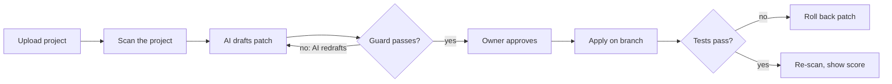

# Cybersecurity Auto-Hardening Assistant: Roadmap and Implementation Guide

Updated Nov 25, 2026

## 1. Goal and ground rules

The assistant adds a security layer around a user's existing website and never rewrites the user's own code. It scans the project, adds missing protections as new files or small insertions, and proves each fix by scanning again.

No tool can automate every part of cybersecurity, so this guide covers what a small website or web app really exposes: accounts and admin access, application code, the hosting network, secrets, data and monitoring.

| Layer | The assistant handles | The owner still handles |
| --- | --- | --- |
| Identity and access | Admin role, role checks, password hashing, MFA, sessions | Deciding who gets admin |
| Application | Validation, injection, XSS, CSRF, headers, CORS, rate limits | Flaws in business logic |
| Network and hosting | Firewall rules, HTTPS, WAF config, least-privilege IAM | Device and physical security |
| Secrets and data | Secret scanning, dependency audit, encryption | Legal review of how data is used |
| Monitoring | Logs, alerts, incident playbook | People who respond around the clock |
| Phishing and social engineering | Nothing | User awareness and training |

Five ground rules apply to every change the assistant makes:

1. Never delete or replace the user's code. Fixes arrive as new files, middleware, configuration or wrapper lines.
2. Edit an existing line only when no additive fix exists, for example a SQL query built by joining strings. Show the diff and ask for approval first.
3. Leave business logic, design and naming alone. Report problems there instead of fixing them.
4. Keep every change reversible: work on a git branch and save one patch file per fix.
5. Say "risk reduced", never "unhackable".

## 2. How the assistant works

The assistant runs a fixed loop of scan, draft, check, approve, apply, test and re-scan, and a patch that fails any check never reaches the user's code.



The AI only drafts patches. The diff guard and the user's own tests decide whether a patch survives: a failed guard sends the draft back to the AI, and a failed test rolls the patch back.

- **Scan:** Semgrep for code flaws, Gitleaks for secrets, a dependency audit, and checks of headers and configuration.
- **Draft:** an AI model such as Claude explains each finding in plain language and writes the smallest patch that fixes it.
- **Guard:** a plain script, not an AI, that rejects any patch removing the user's lines.
- **Approve:** the owner sees the reason and the exact diff before anything is applied.
- **Re-scan:** the same tools run again, and the before and after score is shown.

## 3. Identity and access: making the owner the admin

The site owner becomes admin through a one-time setup step, never through a public form, and every protected action is checked on the server.

1. **Define roles.** Start with two: `admin` and `user`. Add `moderator` only if the site needs it. Give each role the least access it needs.
2. **Bootstrap the first admin.** The assistant adds a setup step that reads the owner's email from an environment variable such as `ADMIN_EMAIL`. The first account verified with that email becomes admin, then the setup route switches itself off.
3. **Never trust the client for roles.** A request field like `role: "admin"` must be ignored. This blocks mass-assignment attacks where a visitor promotes themselves.
4. **Check roles on the server.** Add a middleware such as `requireRole('admin')` to every admin route. Hiding a button in the UI is not security.
5. **Hash passwords properly.** Use Argon2id or bcrypt. Never store plain text, MD5 or SHA-1. Allow long passphrases, enforce a minimum length, and reject common or breached passwords.
6. **Require MFA for admins.** Time-based one-time codes (TOTP) from an authenticator app are enough for a first version.
7. **Secure sessions.** Use cookies marked `HttpOnly`, `Secure` and `SameSite`. Keep access tokens short-lived, rotate refresh tokens, and end all sessions on logout or password change.
8. **Protect the login form.** Rate-limit attempts, add increasing delays after failures, and return the same message for a wrong email and a wrong password so attackers cannot find valid accounts.

**Shortcut on AWS:** Amazon Cognito provides user pools, MFA and groups, so an `admins` group can replace most of steps 2 to 7. It has a free tier, but check its current limits before relying on it.

## 4. Application security

Most website attacks hit the same eight weak spots, and almost all of them can be closed by adding middleware or configuration instead of editing the user's code.

| Threat | What the assistant adds | How it stays additive |
| --- | --- | --- |
| SQL injection | Parameterised queries and input schemas | Flags string-built queries; fixing one is a justified one-line edit with approval |
| Cross-site scripting (XSS) | Output encoding, Content-Security-Policy header, HTML sanitiser | Header and sanitiser added in a new file |
| Cross-site request forgery | `SameSite` cookies and CSRF tokens | Middleware added once |
| Broken access control | Ownership checks so users read only their own data | Guard functions in a new file |
| Weak input handling | Schema validation (zod, Joi or pydantic) at every API entry | Wrapper around existing handlers |
| Missing security headers | CSP, HSTS, X-Content-Type-Options, frame-ancestors, Referrer-Policy | One helper call |
| Loose CORS | Exact origin allow-list, never `*` together with credentials | Replaces one config value |
| Brute force and abuse | Rate limits on login, signup and password reset | Middleware on selected routes |

Two more items complete the list. **File uploads** need type and size limits, random file names, and storage outside the web root such as a private S3 bucket. **Error pages** must hide stack traces in production.

Example for a Node and Express app: the assistant creates one new file and adds a single line to the user's app.

```js
// security.js  (new file added by the assistant)
const helmet = require('helmet');
const rateLimit = require('express-rate-limit');

module.exports = (app) => {
  app.use(helmet());
  app.use('/login', rateLimit({ windowMs: 15 * 60 * 1000, limit: 10 }));
};

// Only line inserted into the user's app, before the routes:
// require('./security')(app);
```

## 5. Network and infrastructure: firewalls and hosting

A firewall decides which traffic may reach the server at all, so the assistant generates rules that close every door except the ones the site needs.

1. **Security groups (AWS firewall).** Allow inbound traffic only on ports 443 and 80. Keep SSH closed, or limit it to your own IP, or use AWS Systems Manager Session Manager and skip SSH entirely. Databases accept traffic only from the app's own security group.
2. **Server firewall.** On a plain Linux server, set `ufw` to deny all incoming traffic by default, then allow 443 and 80. Add `fail2ban` to block repeated failed logins.
3. **HTTPS only.** Request a free certificate from AWS Certificate Manager, redirect HTTP to HTTPS, and send the HSTS header.
4. **Hide the origin.** Serve the site through CloudFront. Keep S3 buckets private and let only CloudFront read them. Block public access on every bucket.
5. **Web application firewall (WAF).** AWS WAF managed rule groups block common injection and bad-input patterns in front of CloudFront or an API. AWS WAF is a paid service, so for a free-tier build the assistant should generate the rule set as an optional step and rely on API Gateway throttling and app-level protections meanwhile.
6. **DDoS.** AWS Shield Standard is included automatically for AWS customers at no extra charge. CloudFront adds more absorption.
7. **Least-privilege IAM.** Turn on MFA for the root account and stop using it. Give each service its own role with only the permissions it needs, and avoid wildcard (`*`) policies.
8. **Encrypt storage.** Turn on default encryption for S3, DynamoDB and any database.

Check current pricing for WAF, GuardDuty and Security Hub before enabling them. Any service that bills outside the free tier should be a clearly marked option, not a default.

## 6. Secrets, dependencies and data protection

Leaked keys and outdated libraries cause more real breaches than clever hacking, so the assistant checks these first.

**Secrets**

- Scan the code and the full git history with Gitleaks. A key that was ever committed counts as leaked, even if it was deleted later, so rotate it immediately.
- Move secrets into environment variables and add `.env` to `.gitignore`. On AWS, SSM Parameter Store standard parameters are free; Secrets Manager is paid.
- Never print secrets, tokens or passwords in logs.

**Dependencies**

- Run `npm audit`, `pip-audit` or OSV-Scanner and list vulnerable packages with the safe version to upgrade to.
- Commit the lockfile and enable automated update alerts such as Dependabot.
- Upgrades can break things, so the assistant proposes them as a separate patch and runs the user's tests first.

**Data**

- Encrypt data in transit (HTTPS) and at rest (S3, DynamoDB and database encryption).
- Collect only the personal data the site needs, and keep a tested backup.
- Sites handling personal data of people in India should check obligations under the Digital Personal Data Protection Act, 2023, including consent and minimal collection.

## 7. Monitoring, logging and incident response

Prevention will sometimes fail, so the assistant also sets up the means to notice an attack quickly and respond in a fixed order.

**What to log:** logins and failed logins, password resets, role changes, admin actions, and server errors. Keep logs in Amazon CloudWatch Logs and leave out passwords, tokens and full card or ID numbers.

**What to alert on:** a burst of failed logins, a sudden rise in 4xx or 5xx errors, a new admin account, and any change to IAM permissions. CloudWatch alarms can send these to an email address through Amazon SNS. AWS CloudTrail records account activity; its 90-day event history is on by default.

**Incident playbook** (the assistant generates this as a short checklist for the owner):

1. Detect: confirm the alert is real and note the time.
2. Contain: disable the affected account, rotate exposed keys, and block the attacking IP.
3. Eradicate: remove the cause, such as the vulnerable code path or the leaked secret.
4. Recover: restore from the last clean backup and watch the logs closely.
5. Review: write down what happened, and add a test so it cannot recur.

## 8. UI performance: a lighter login and smoother animations

A fast login page mostly comes from loading less on it, and smooth animation comes from animating only what the browser can draw cheaply. Each fix below is chosen because it needs very few changed lines.

**Lighter login page (less memory, faster start)**

1. **Load only what login needs.** Wrap the post-login screens in `React.lazy` and `Suspense` (or the framework's dynamic import). Charts, editors and big UI kits then download only after sign-in. This is usually a one-line change per import.
2. **Keep typing local.** Store keystrokes in the form's own state or an uncontrolled input, not in global state, so typing does not re-render the whole page. Debounce live validation by 200 to 300 ms.
3. **Trim assets.** Use compressed WebP or AVIF images, lazy-load anything below the fold, set `font-display: swap`, and drop autoplay video or heavy backgrounds from the login screen.
4. **Clean up after yourself.** Remove event listeners, timers and subscriptions in effect cleanups. Forgotten ones are a common source of memory growth.
5. **Cache and compress.** Serve hashed static files with long cache lifetimes and Brotli or gzip compression. CloudFront does this with little configuration.
6. **Tune password hashing to the server.** Argon2 uses memory on purpose. OWASP's minimum Argon2id setting is 19 MiB of memory, 2 iterations and 1 lane. On a small Lambda or server, use that minimum or bcrypt with a cost of 10 to 12 so logins stay fast without losing safety.

**Smoother animations**

- Animate `transform` and `opacity` only. Changing `width`, `height`, `top`, `left` or `margin` forces the browser to recalculate layout on every frame.
- Prefer CSS transitions over JavaScript timers. When JavaScript is needed, use `requestAnimationFrame`.
- Keep durations at 150 to 300 ms with an ease-out curve.
- Avoid animating large shadows, blurs or `backdrop-filter`. Use `will-change` sparingly and only on elements about to animate.
- Respect `prefers-reduced-motion` for users who ask for less movement.
- Virtualise long lists so only visible rows exist in the page.

Example of a minimal edit. Only the animated rule changes; the rest of the stylesheet is untouched, and the original rule stays in the patch file.

```css
/* before */
.card:hover { margin-top: -4px; transition: all .5s; }

/* after */
.card { transition: transform .2s ease-out; }
.card:hover { transform: translateY(-4px); }
```

**How to measure.** Use Lighthouse and the Chrome DevTools Performance and Memory tabs before and after. Good targets are Largest Contentful Paint under 2.5 s, Interaction to Next Paint under 200 ms and Cumulative Layout Shift under 0.1.

## 9. Safe patching: keeping the user's code untouched

The promise "we never replace your code" is enforced by a checker in the pipeline, not by trusting the AI to behave.

| Change class | Example | What the assistant may do |
| --- | --- | --- |
| Additive | New `security.js`, headers, rate limits, firewall config, CI scan | Apply after the owner approves the patch |
| Minimal edit | Replace a string-built SQL query, change `origin: '*'`, swap an unsafe `innerHTML` | Show the exact diff and apply only after approval of that change |
| UI optimisation | Lazy-load an import, change an animated CSS property | Apply as a separate, optional patch set with before and after screenshots |
| Out of scope | Business logic, layout, naming, features | Report only; never change |

Process for every fix:

1. **Snapshot first.** Copy the project to a new git branch so the original is always recoverable.
2. **Generate a unified diff, never a rewritten file.** The AI returns only the lines to add or change.
3. **Run the diff guard.** A script counts deleted lines. A patch that deletes or alters lines outside the approved patterns, or exceeds a set size, is rejected automatically.
4. **Match the style.** Keep the user's formatting, comments and naming so the diff stays small.
5. **Build and test.** Run the user's existing tests or build before and after. If anything that passed now fails, roll back that patch.
6. **Log it.** Each change records the reason, the risk it reduces and the one-line command that reverts it.

The diff guard is the strongest answer to a judge who asks "how do you know the AI did not break my code?".

## 10. Phased roadmap and 6-day build plan

The hackathon build is Phase 1 of the roadmap: a working first version live on AWS by Nov 26, finished and submitted by Nov 29.

```mermaid
gantt
    title Submit on Nov 29 and keep Nov 30 as a spare day
    dateFormat YYYY-MM-DD
    axisFormat %b %d
    section Build
    AWS setup and login        :2026-11-25, 2d
    Scanner + patch engine     :2026-11-26, 3d
    Diff guard + rollback      :2026-11-27, 2d
    UI speed optimiser         :2026-11-27, 2d
    section Story and submit
    Pilot on real sites        :2026-11-28, 2d
    Brief, summary, video      :2026-11-28, 2d
    Submit to Techfest         :milestone, 2026-11-29, 0d
    Deadline 11:59 PM IST      :milestone, crit, 2026-11-30, 0d
```

The build overlaps on purpose. Scanning and the diff guard run in parallel with the UI work, and the real-site pilot starts as soon as one full flow works end to end. Only the team leader can submit, so decide who that is today.

| Role | Owns | Hand-off |
| --- | --- | --- |
| Cloud and backend | AWS account and budget alert, API, storage, deployment, uptime until Demo Day | Live URL by Nov 26 |
| AI and scanning | Scanner integration, prompts, diff guard, rollback | Patch pipeline by Nov 27 |
| Frontend and UX | Upload, findings and diff-approval screens, UI optimiser | Working screens by Nov 28 |
| Impact and story | Pilot on real sites, idea brief, build summary, demo video, Drive folder | Submission pack by Nov 29 |

**After the hackathon:**

1. Phase 1 (hackathon): check registry with the quick wins, diff guard, live demo.
2. Phase 2: support more stacks such as Django, Flask and PHP, and open pull requests directly on GitHub.
3. Phase 3: scheduled re-scans, alerts and a security score history.
4. Phase 4: guided WAF setup and reports aimed at compliance.

## 11. Testing and verification

Every fix must be proven by a before and after check, and the assistant only claims what a tool confirmed.

| Check | Tool | Pass condition |
| --- | --- | --- |
| Code vulnerabilities | Semgrep | Planted flaws no longer reported |
| Leaked secrets | Gitleaks | Zero findings in code and history |
| Vulnerable packages | npm audit, pip-audit or OSV-Scanner | No high or critical issues left |
| Live site weaknesses | OWASP ZAP baseline scan | Missing-header and cookie warnings cleared |
| Security headers | A header check on the deployed URL | CSP, HSTS and the other headers present |
| Speed and memory | Lighthouse, DevTools Performance and Memory | Scores and heap size improve |
| Accessibility | axe-core | No new violations |
| Nothing broken | The user's own tests | Same results as before the patch |
| Code untouched | Diff guard | Zero deleted lines outside approved patterns |

Build a deliberately vulnerable demo app with about eight planted flaws: a hardcoded API key, string-built SQL, no security headers, open CORS, no rate limit, a public admin route, an outdated package and a heavy login page. Run the assistant on it and show the scores before and after.

Only scan sites you own or have written permission to test. Scanning other people's sites is illegal.

## 12. Hackathon fit, demo plan and honest limits

As a general developer tool this idea risks a low Bharat Impact score, which is 30% of the Campus to Cloud judging, so it must be framed around people in India who have no security help.

**Framing.** Aim it at student founders, college clubs and fest websites, small shops going online, NGOs and small local organisations that launch a website with no security team. Say who they are and why a breach hurts them. Do not claim statistics you have not verified.

**Prove impact with a pilot.** Run the assistant on 3 to 5 real sites that people have agreed to share, and report the before and after scores. Real numbers beat general claims.

**Scoring map**

| Criterion | Weight | How this project answers it |
| --- | --- | --- |
| Bharat Impact | 30% | Pilot on real small Indian sites; plain-language fixes for non-experts |
| Working AWS build | 25% | Live URL; Lambda, API Gateway, S3, DynamoDB, Cognito, CloudFront, Bedrock |
| Innovation | 25% | Diff guard that never replaces user code, plus a security and speed fix in one pass |
| Demo and storytelling | 20% | Vulnerable site fixed live with a score that jumps |

**3-minute demo script:** 0:00 to 0:30 the problem and who it hurts; 0:30 to 2:00 paste a vulnerable site, show findings, approve patches, re-scan; 2:00 to 2:30 the diff guard proving no code was removed; 2:30 to 3:00 pilot results and what comes next.

**MVP for 6 days.** Do not try to cover every aspect. Build the check registry from section 13 and run its quick wins automatically, plus security headers, admin role setup and generated firewall rules. Treat the rest of this guide as the roadmap after the hackathon.

**Honest limits.** The assistant reduces risk but cannot guarantee safety. It does not replace a professional audit, it cannot find every business-logic flaw, and it should never run uploaded code on its own server without a sandbox.

## 13. Production-readiness checklist: what the assistant checks, adds and improves

A site is ready for real users only when delivery, recovery, monitoring and trust basics are in place as well as security, so the assistant runs a registry of 32 checks. Each check has three parts: a detector that finds the gap, a fixer that adds the missing piece without touching existing code, and a verifier that proves the gap is closed.

The Mode column says how far the assistant can go:

- **Auto:** added as new files or configuration after the owner approves the patch.
- **Template:** a generated draft that the owner must review or complete, because it depends on their account, data or legal position.
- **Report:** the assistant only reports the finding and prepares evidence.

**A. Delivery and recovery**

| Check | How it is detected | What the assistant adds or reports | Mode |
| --- | --- | --- | --- |
| CI/CD | No workflow file in the repo | GitHub Actions workflow that builds, tests and scans on every push | Auto |
| Unit tests | No test folder, or critical paths untested | Starter tests for login, validation and role checks, in new files | Auto |
| Staging environment | Only one deploy target in the config | Second environment config and a deploy-to-staging step | Template |
| Rollback plan | No tagged releases or revert steps | Versioned deploy script and a one-page rollback checklist | Template |
| Database backup | No backup schedule found | Backup settings such as RDS automated backups or DynamoDB point-in-time recovery | Auto |
| Restore test | No record that a backup was restored | Scheduled restore-drill script that logs the result | Template |
| README | Missing or empty | README covering setup, environment variables and deployment | Auto |

**B. Monitoring and cost**

| Check | How it is detected | What the assistant adds or reports | Mode |
| --- | --- | --- | --- |
| Performance monitoring | No metrics or tracing | CloudWatch metrics and alarms on latency and errors; Lighthouse CI for the front end | Auto |
| Error tracking | No global error handler | Handler that logs errors to CloudWatch, with an optional hook for a tracker such as Sentry | Auto |
| Uptime monitoring | No health endpoint | A `/health` route plus steps for a free uptime pinger or a Route 53 health check | Auto |
| Spend caps and billing alerts | No budget alert on the cloud account | AWS Budgets alert at fixed thresholds, and a usage cap in code for paid external APIs | Template |

**C. Security basics**

| Check | How it is detected | What the assistant adds or reports | Mode |
| --- | --- | --- | --- |
| Auth on every endpoint | Route scan finds endpoints with no auth or role middleware | Default-deny guard, so a new route needs login unless marked public (section 3) | Auto |
| Dependency audit | Audit tool reports known vulnerabilities | Safe upgrades proposed as a separate patch (section 6) | Auto |
| Secrets out of the repo | Gitleaks finds keys in code or git history | Environment variables and an updated `.gitignore` (section 6) | Auto |
| Rotate leaked keys | A key found in history | Each exposed key with the provider's rotation steps; the owner performs the rotation | Report |
| Rate limiting | No limiter on login, signup, reset or costly routes | Limiter middleware (section 4) | Auto |
| Password reset works | Reset flow missing, or tokens reusable or long-lived | Single-use, short-lived reset tokens and a test for the flow | Auto |
| Delete account and data | No delete route | Delete-account endpoint with confirmation that removes the user's records and sessions | Template |

**D. Domain, email and legal**

| Check | How it is detected | What the assistant adds or reports | Mode |
| --- | --- | --- | --- |
| Custom domain and SSL | Site served on a default URL or over HTTP | Route 53, ACM and CloudFront setup steps, plus a forced HTTPS redirect | Template |
| Email authentication (SPF, DKIM, DMARC) | DNS lookup of the sending domain | The exact DNS records to add, then a check that they resolve | Template |
| Sending domain off blocklists | Domain and IP checked against public blocklists | Any listing found, with delisting steps | Report |
| Privacy policy and terms | Pages missing | Draft pages built from the data the app really collects; a lawyer should review them | Template |

**E. User-facing states**

| Check | How it is detected | What the assistant adds or reports | Mode |
| --- | --- | --- | --- |
| Real 404, 500, empty and loading states | Routes with no error page, no empty-list message or no loader | Simple error pages, empty-state messages and loading placeholders as new components | Auto |

**F. AI features (only when the app calls a language model)**

| Check | How it is detected | What the assistant adds or reports | Mode |
| --- | --- | --- | --- |
| Evals | No test set for model answers | Starter set of test prompts with expected behaviour, and a script that scores them | Template |
| Prompt injection tests | User text mixed into instructions | A list of known injection patterns as tests, and guidance to keep user input apart from instructions | Template |
| Fallback when the model API is down | Model calls with no timeout or fallback | Timeout, retry and a friendly fallback message | Auto |

**G. Enterprise and audits**

Software cannot pass an audit on its own, because outside assessors decide the result. For these items the assistant saves the owner time by collecting evidence and drafting documents, and it says plainly that the audit itself is still needed.

| Check | How it is detected | What the assistant adds or reports | Mode |
| --- | --- | --- | --- |
| Penetration test | No test report on file | Scan results, a scope note and a fix list to hand to the tester | Report |
| Google CASA security assessment | App uses sensitive Google data scopes | Evidence pack for an authorised assessor | Report |
| Microsoft security audit | App is sold into Microsoft-based organisations | Evidence pack for the review | Report |
| Data processing agreement (DPA) with each customer | Business customers and no DPA template | Draft DPA for a lawyer to review | Template |
| 200-question security questionnaire | Customer sends one | Answers pre-filled from scan results and configuration, with unanswerable questions flagged | Template |
| SSO and audit logs | No single sign-on; admin actions not logged | Audit-log events for admin actions (section 7) and SSO set-up steps through Cognito federation | Template |

**How the checks keep improving the site**

1. **Run on every push.** The generated CI workflow calls the assistant, so a gap that comes back is caught right away.
2. **Readiness score.** The dashboard shows how many of the 32 checks pass, with security items listed first, and keeps the history so the owner sees progress.
3. **Fix order.** Security first, then backups and rollback, then monitoring, then trust and legal items.
4. **Open a task for each failure.** Each failed check becomes one small patch or one owner task with the exact steps.

**What to build first for the hackathon.** Implement the registry and its detect, fix and verify structure, then wire up these quick wins: secrets out of the repo, dependency audit, auth on every endpoint, rate limiting, error and loading states, README generation and the billing-alert template. The remaining checks stay in the registry as report-only or template entries, so the demo shows the full list while only the quick wins run automatically.
